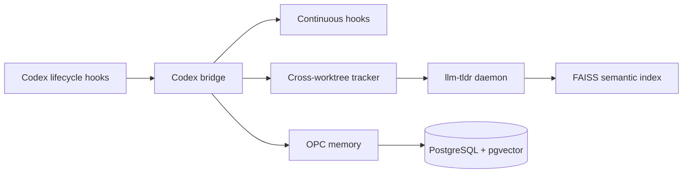

# codex-continuous-patcher

A Linux adapter that brings [Continuous-Claude-v3](https://github.com/parcadei/Continuous-Claude-v3) to Codex CLI: lifecycle hooks, five-layer TLDR analysis, FAISS semantic search, PostgreSQL/pgvector memory, and continuity handoffs.

[中文](README.md) · [MIT License](LICENSE)


## What it is

Continuous-Claude-v3 was built for Claude Code. This project keeps its source hooks, skills, MCP configuration, and OPC memory runtime, then adds a Linux bridge for Codex lifecycle events and tool payloads.

The result is a long-running Codex workspace with structured code navigation, semantic retrieval, cross-session memory, and compaction handoffs while preserving the original Python `llm-tldr` implementation.



## Core capabilities

- **Hook bridge** — translates Codex `Bash`, `Edit`, `Write`, `Grep`, and lifecycle payloads into the format expected by Continuous-Claude; one bridge process dispatches each event.
- **Upstream TLDR** — uses `llm-tldr==1.5.2` for AST, Call Graph, CFG, DFG, and PDG analysis, a Unix-socket daemon, FAISS semantic indexes, and dirty-file tracking.
- **Background warming** — SessionStart/resume can asynchronously warm structural and semantic indexes for small Git worktrees while normal search remains responsive.
- **Cross-repository tracking** — when Codex works in repo-a but an absolute-path command edits an indexed repo-b, the tracker notifies repo-b's daemon.
- **Continuity memory** — stores learnings, decisions, and handoff data in Docker-backed PostgreSQL + pgvector.
- **Off-context RLM** — ports ContinuousClaudeV4.7's Ouros persistent REPL, `llm_call`/`agent_call` recursion bridge, and v4.7 skills/agents. Bash is rewritten during PreToolUse to execute through `codex_continuous_rlm.py --exec`; the runner captures stdout/stderr before the tool result exists. Above the default 48 KiB it writes the full result under `/tmp/codex-continuous-rlm/`, prints only a bounded card to stdout, and preserves the original return code. If artifact storage fails, it emits a UTF-8-safe 48 KiB fallback instead of swallowing the command output. RLM no longer appends summaries in PostToolUse.
- **Safe defaults** — Subagents and Braintrust are disabled by default; semantic work is guarded by source-size, `.tldrignore`, and low-parallelism limits.

## Quick start

Requirements: Linux, Codex CLI, `uv`, Docker Compose, and Python 3.12+ for the OPC memory runtime.

```bash
git clone https://github.com/parcadei/Continuous-Claude-v3.git ../Continuous-Claude-v3
git clone https://github.com/xiaoyu1738/codex-continuous-patcher.git
cd codex-continuous-patcher

./install.sh --source ../Continuous-Claude-v3
```

Use an explicit source path when the Continuous-Claude clone lives elsewhere:

```bash
./install.sh --source /path/to/Continuous-Claude-v3
```

The installer:

1. Deploys adapted resources under `$CODEX_HOME/continuous-claude-v3`.
2. Registers Codex lifecycle hooks and persists hook trust fingerprints.
3. Installs the Codex-compatible v3 skills, 9 v4.7 RLM skills, and validated MCP configuration.
4. Installs `llm-tldr`, FAISS, Sentence Transformers, and PyTorch.
5. Installs the Ouros RLM runtime and the `ouros-harness` launcher.
6. Starts the PostgreSQL/pgvector memory stack.

Converted Continuous subagents are not installed or registered by default; Braintrust is also disabled by default.

## Installation configuration

The repository's [`codex-continuous.config.json`](codex-continuous.config.json) controls optional components:

```json
{
  "subagents": { "enabled": false },
  "dashboard": { "enabled": true },
  "braintrust": { "enabled": false },
  "memory": {
    "auto_learning": { "enabled": true },
    "shared_model_cache": { "enabled": true }
  },
  "handoff": { "manual_compact": { "enabled": true } },
  "tldr": { "model": "bge-large-en-v1.5" }
}
```

When `subagents.enabled` is `true`, the installer converts and registers the Continuous agent roles and enables Codex's multi-agent settings. When it is `false`, those roles are neither installed nor registered. `dashboard.enabled` only controls whether the local dashboard script is copied; it does not start a web server.
`memory.auto_learning.enabled` controls local learning extraction from test results, user confirmations, and tool actions. `braintrust.enabled` is disabled by default; when disabled, Braintrust hooks are not registered. `handoff.manual_compact.enabled` controls YAML handoff creation for user-triggered `/compact`. `memory.shared_model_cache.enabled` makes memory and TLDR share `~/.cache/huggingface` and the same BGE model by default.

Run the installer next to the configuration file:

```bash
./install.sh
```

You can also provide another JSON file or override its values for one installation:

```bash
./install.sh --config /path/to/codex-continuous.config.json
./install.sh --enable-subagents
./install.sh --disable-subagents
./install.sh --disable-dashboard
```

CLI flags take precedence over JSON. Rerun the installer after changing the configuration to switch the feature set; the default local configuration keeps subagents disabled.

## Semantic search

Build an index for a repository:

```bash
tldr semantic index /path/to/repository \
  --lang all \
  --model bge-large-en-v1.5
```

Query it:

```bash
tldr semantic search "authentication token validation" \
  --path /path/to/repository \
  --k 5
```

The upstream artifacts live inside the repository:

```text
repository/.tldr/cache/semantic/index.faiss
repository/.tldr/cache/semantic/metadata.json
```

Indexes are independent per repository. The Codex hook tracks common absolute-path shell edits across Git worktrees; the daemon rebuilds in the background after roughly 20 distinct changed source files.

If an automatic semantic query has no usable index, it fails open to ordinary search instead of synchronously starting a full-project PyTorch build inside the search hook.

## Memory and handoffs

Memory uses local PostgreSQL/pgvector by default. Query it manually:

```bash
CODEX_HOME="${CODEX_HOME:-$HOME/.codex}"
cd "$CODEX_HOME/continuous-claude-v3/opc"
PYTHONPATH=. uv run python scripts/core/recall_learnings.py \
  --query "hook development patterns" \
  --k 3
```

Before automatic or manual Codex compaction, the bridge writes:

```text
thoughts/shared/handoffs/codex/auto-handoff-*.yaml
```

Automatic handoffs are scoped by the Codex `session_id`: only the current session's checkpoint is loaded after compaction, and automatic checkpoints expire after 24 hours. A new session does not load another session's handoff automatically; use `/resume_handoff` for long-lived explicit handoffs.

Memory embeddings and TLDR semantic indexes use `bge-large-en-v1.5` by default and share one model cache:

```text
~/.cache/huggingface
```

The next context window loads that state in the same Codex thread; it does not create a second chat.

## Off-context RLM

After installation, run the v4.7 Ouros harness directly:

```bash
ouros-harness --file /tmp/research.py \
  --session auth-patterns \
  --storage continuum/rlm/sessions
```

Ouros sessions persist raw variables; `--load` resumes them and `--fork` creates an independent branch. Large stdout is written to `continuum/rlm/sessions/outputs/`, while the terminal receives only an artifact path, bounded preview, and digest. The default RLM boundary is 48 KiB and storage failure falls back to a UTF-8-safe truncated output. Automatic TLDR runs only for repositories with at least 80 code files or 512 KiB of code; the scale walk exits as soon as either threshold is reached. The Bash boundary runs in PreToolUse. The temporary command script is deleted immediately after return; orphan scripts and artifacts are reaped on the next runner start with a default 24-hour TTL and a 256 MiB total cap. Large code reads use the v4.7 `tldr-read.mjs` hook to inject a structural map and cap the first read; use `offset`/`limit` for exact follow-up reads. PostToolUse no longer performs RLM summarization.

For CUA/browser-like stdio MCP servers, the installer can register `codex_continuous_mcp_filter.py` in the generated MCP catalog. It removes `data:image/...;base64` payloads and clips oversized text from JSON-RPC responses before they reach the MCP client. Remote HTTP MCP servers cannot be intercepted by this stdio proxy and require filtering at the gateway or server.

The Git MCP server is not pinned to `--repository .`: Codex app-server is a long-lived process whose cwd may belong to a different session, so that relative path can make the server exit before the handshake. Git tool calls pass the target repository through the required `repo_path` argument.

## Status and dashboard

Inspect the installed runtime:

```bash
CODEX_HOME="${CODEX_HOME:-$HOME/.codex}"
python3 "$CODEX_HOME/continuous-claude-v3/codex_continuous_status.py" \
  --project "$PWD"
```

Start the local dashboard:

```bash
CODEX_HOME="${CODEX_HOME:-$HOME/.codex}"
python3 "$CODEX_HOME/continuous-claude-v3/codex_continuous_dashboard.py" \
  --project "$PWD"
```

Open `http://127.0.0.1:8765`. The dashboard reports hooks, skills, MCP, memory, Docker, TLDR, and handoff state.

## Development and verification

```bash
PYTHONPATH=. python3 -m unittest discover -s tests -v
python3 -m py_compile *.py
```

The adapter test suite covers the bridge, installer configuration, search routing, semantic warming, cross-worktree change tracking, TLDR compatibility, and RLM artifact/hook/runtime boundaries.

## Boundaries

- This is a Linux adapter; Codex CLI and upstream source changes require revalidation.
- FAISS indexes are stored per repository; a repository without an index is not forced into a synchronous embedding build by ordinary search.
- Tracking is hook-based rather than a global filesystem watcher. Common absolute-path commands are tracked; arbitrary background processes or container-internal edits may require an explicit reindex.
- `llm-tldr` is an independent AGPL-3.0 dependency installed from PyPI and is not vendored here. The adapter itself is MIT licensed.

## Uninstall

```bash
./install.sh --uninstall
```

Uninstall removes resources generated by this adapter—Codex hooks, MCP entries, skills, rules, and feature registrations. The PostgreSQL Docker volume is retained by default.

## License

This adapter is released under the [MIT License](LICENSE). Third-party dependencies retain their respective licenses.
