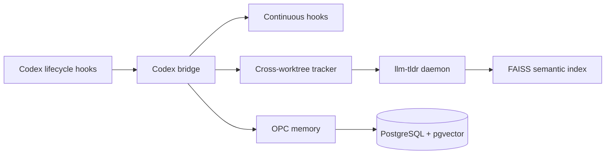

# codex-continuous-patcher

A Linux adapter that brings [Continuous-Claude-v3](https://github.com/parcadei/Continuous-Claude-v3) to Codex CLI: lifecycle hooks, five-layer TLDR analysis, FAISS semantic search, PostgreSQL/pgvector memory, and continuity handoffs.

[中文](README.md) · [MIT License](LICENSE)


## What it is

Continuous-Claude-v3 was built for Claude Code. This project keeps its source hooks, skills, MCP configuration, and OPC memory runtime, then adds a Linux bridge for Codex lifecycle events and tool payloads.

The result is a long-running Codex workspace with structured code navigation, semantic retrieval, cross-session memory, and compaction handoffs while preserving the original Python `llm-tldr` implementation.



## Core capabilities

- **Hook bridge** — translates Codex `Bash`, `Edit`, `Write`, `Grep`, and lifecycle payloads into the format expected by Continuous-Claude; one bridge process dispatches each event.
- **Upstream TLDR** — uses `llm-tldr==1.5.2` for AST, Call Graph, CFG, DFG, and PDG analysis, a Unix-socket daemon, FAISS semantic indexes, and dirty-file tracking.
- **Background warming** — SessionStart/resume can asynchronously warm structural and semantic indexes for small Git worktrees while normal search remains responsive.
- **Cross-repository tracking** — when Codex works in repo-a but an absolute-path command edits an indexed repo-b, the tracker notifies repo-b's daemon.
- **Continuity memory** — stores learnings, decisions, and handoff data in Docker-backed PostgreSQL + pgvector.
- **Safe defaults** — Subagents and Braintrust are disabled by default; semantic work is guarded by source-size, `.tldrignore`, and low-parallelism limits.

## Quick start

Requirements: Linux, Codex CLI, `uv`, Docker Compose, and Python 3.12+ for the OPC memory runtime.

```bash
git clone https://github.com/parcadei/Continuous-Claude-v3.git ../Continuous-Claude-v3
git clone https://github.com/xiaoyu1738/codex-continuous-patcher.git
cd codex-continuous-patcher

./install.sh --source ../Continuous-Claude-v3
```

Use an explicit source path when the Continuous-Claude clone lives elsewhere:

```bash
./install.sh --source /path/to/Continuous-Claude-v3
```

The installer:

1. Deploys adapted resources under `$CODEX_HOME/continuous-claude-v3`.
2. Registers Codex lifecycle hooks and persists hook trust fingerprints.
3. Installs 108 namespaced skills and enabled MCP configuration.
4. Installs `llm-tldr`, FAISS, Sentence Transformers, and PyTorch.
5. Starts the PostgreSQL/pgvector memory stack.

Converted Continuous subagents are not installed or registered by default; Braintrust is also disabled by default.

## Installation configuration

The repository's [`codex-continuous.config.json`](codex-continuous.config.json) controls optional components:

```json
{
  "subagents": { "enabled": false },
  "dashboard": { "enabled": true }
}
```

When `subagents.enabled` is `true`, the installer converts and registers the Continuous agent roles and enables Codex's multi-agent settings. When it is `false`, those roles are neither installed nor registered. `dashboard.enabled` only controls whether the local dashboard script is copied; it does not start a web server.

Run the installer next to the configuration file:

```bash
./install.sh
```

You can also provide another JSON file or override its values for one installation:

```bash
./install.sh --config /path/to/codex-continuous.config.json
./install.sh --enable-subagents
./install.sh --disable-subagents
./install.sh --disable-dashboard
```

CLI flags take precedence over JSON. Rerun the installer after changing the configuration to switch the feature set; the default local configuration keeps subagents disabled.

## Semantic search

Build an index for a repository:

```bash
tldr semantic index /path/to/repository \
  --lang all \
  --model all-MiniLM-L6-v2
```

Query it:

```bash
tldr semantic search "authentication token validation" \
  --path /path/to/repository \
  --k 5
```

The upstream artifacts live inside the repository:

```text
repository/.tldr/cache/semantic/index.faiss
repository/.tldr/cache/semantic/metadata.json
```

Indexes are independent per repository. The Codex hook tracks common absolute-path shell edits across Git worktrees; the daemon rebuilds in the background after roughly 20 distinct changed source files.

If an automatic semantic query has no usable index, it fails open to ordinary search instead of synchronously starting a full-project PyTorch build inside the search hook.

## Memory and handoffs

Memory uses local PostgreSQL/pgvector by default. Query it manually:

```bash
CODEX_HOME="${CODEX_HOME:-$HOME/.codex}"
cd "$CODEX_HOME/continuous-claude-v3/opc"
PYTHONPATH=. uv run python scripts/core/recall_learnings.py \
  --query "hook development patterns" \
  --k 3
```

Before automatic Codex compaction, the bridge writes:

```text
thoughts/shared/handoffs/codex/auto-handoff-*.yaml
```

The next context window loads that state in the same Codex thread; it does not create a second chat.

## Status and dashboard

Inspect the installed runtime:

```bash
CODEX_HOME="${CODEX_HOME:-$HOME/.codex}"
python3 "$CODEX_HOME/continuous-claude-v3/codex_continuous_status.py" \
  --project "$PWD"
```

Start the local dashboard:

```bash
CODEX_HOME="${CODEX_HOME:-$HOME/.codex}"
python3 "$CODEX_HOME/continuous-claude-v3/codex_continuous_dashboard.py" \
  --project "$PWD"
```

Open `http://127.0.0.1:8765`. The dashboard reports hooks, skills, MCP, memory, Docker, TLDR, and handoff state.

## Development and verification

```bash
PYTHONPATH=. python3 -m unittest discover -s tests -v
python3 -m py_compile *.py
```

The adapter test suite covers the bridge, installer configuration, search routing, semantic warming, cross-worktree change tracking, and TLDR compatibility layer.

## Boundaries

- This is a Linux adapter; Codex CLI and upstream source changes require revalidation.
- FAISS indexes are stored per repository; a repository without an index is not forced into a synchronous embedding build by ordinary search.
- Tracking is hook-based rather than a global filesystem watcher. Common absolute-path commands are tracked; arbitrary background processes or container-internal edits may require an explicit reindex.
- `llm-tldr` is an independent AGPL-3.0 dependency installed from PyPI and is not vendored here. The adapter itself is MIT licensed.

## Uninstall

```bash
./install.sh --uninstall
```

Uninstall removes resources generated by this adapter—Codex hooks, MCP entries, skills, rules, and feature registrations. The PostgreSQL Docker volume is retained by default.

## License

This adapter is released under the [MIT License](LICENSE). Third-party dependencies retain their respective licenses.
