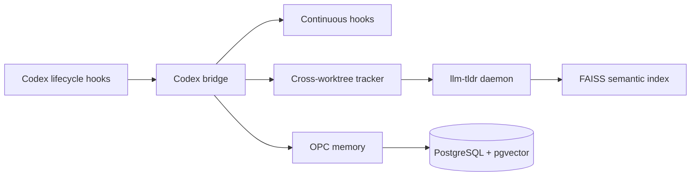

# codex-continuous-patcher

把 [Continuous-Claude-v3](https://github.com/parcadei/Continuous-Claude-v3) 的连续工作能力接入 Linux Codex CLI：hooks、TLDR 五层代码分析、FAISS 语义搜索、PostgreSQL/pgvector 记忆和自动交接。

[English](README.en.md) · [MIT License](LICENSE)


## 这是什么

Continuous-Claude-v3 原本面向 Claude Code。这个项目保留它的源 hooks、skills、MCP 和 OPC memory runtime，再通过一个 Linux bridge 适配 Codex 的生命周期事件和工具格式。

它的目标很简单：让 Codex 在长任务中拥有稳定的代码导航、语义检索、跨会话记忆和 compaction handoff，同时保留原版 `llm-tldr` 的实现。



## 核心能力

- **Hook bridge**：把 Codex 的 `Bash`、`Edit`、`Write`、`Grep` 和生命周期 payload 转成 Continuous-Claude 能理解的格式；每个事件由一个 bridge 进程统一调度。
- **原版 TLDR**：使用 `llm-tldr==1.5.2`，提供 AST、Call Graph、CFG、DFG、PDG 五层分析、Unix socket daemon、FAISS 语义索引和增量 dirty tracking。
- **后台预热**：SessionStart/resume 时，对小型 Git 项目异步建立结构缓存和语义索引；建索引期间普通搜索继续工作。
- **跨仓库修改追踪**：Codex 在 repo-a 中工作、通过绝对路径修改已建立索引的 repo-b 时，tracker 会通知 repo-b 的 daemon。
- **连续记忆**：通过 Docker PostgreSQL + pgvector 保存 learnings、决策和交接信息。
- **RLM 盘外上下文**：集成 ContinuousClaudeV4.7 的 Ouros 持久化 REPL、`llm_call`/`agent_call` 递归桥接和 v4.7 skills/agents。Bash 在 PreToolUse 阶段被改写为 `codex_continuous_rlm.py --exec`，原命令的 stdout/stderr 在工具执行前就由 runner 捕获；超过 4000 字节时只把摘要卡片写入 stdout，完整结果保存到 `/tmp/codex-continuous-rlm/`，并透传原始 returncode。RLM 不再通过 PostToolUse 追加摘要卡片。
- **安全默认值**：Subagents 和 Braintrust 默认关闭；语义搜索有源码数量、大小、`.tldrignore` 和低并行度限制。

## 快速开始

需要 Linux、Codex CLI、`uv`、Docker Compose，以及 Python 3.12+ 运行 OPC memory。

```bash
git clone https://github.com/parcadei/Continuous-Claude-v3.git ../Continuous-Claude-v3
git clone https://github.com/xiaoyu1738/codex-continuous-patcher.git
cd codex-continuous-patcher

./install.sh --source ../Continuous-Claude-v3
```

如果源码 clone 在其他位置：

```bash
./install.sh --source /path/to/Continuous-Claude-v3
```

安装器会：

1. 把适配后的资源部署到 `$CODEX_HOME/continuous-claude-v3`。
2. 注册 Codex lifecycle hooks，并保存 hook trust fingerprints。
3. 安装 108 个 v3 skills、9 个 v4.7 RLM skills 和启用的 MCP 配置。
4. 安装 `llm-tldr`、FAISS、Sentence Transformers 和 PyTorch。
5. 安装 Ouros RLM 运行时和 `ouros-harness` 启动器。
6. 启动 PostgreSQL/pgvector memory stack。

默认安装不会注册 Continuous 的 converted subagents；Braintrust 也默认不启用。

## 安装配置

仓库根目录的 [`codex-continuous.config.json`](codex-continuous.config.json) 控制可选组件：

```json
{
  "subagents": { "enabled": false },
  "dashboard": { "enabled": true }
}
```

`subagents.enabled` 为 `true` 时，安装器才会转换并注册 Continuous 的 agent roles，同时打开 Codex 的 multi-agent 设置；为 `false` 时不会安装或注册这些 roles。`dashboard.enabled` 只控制是否复制本地 dashboard 脚本，不会自动启动网页服务。

配置文件旁边运行安装器即可生效：

```bash
./install.sh
```

也可以指定其他 JSON 配置，或用命令行临时覆盖配置：

```bash
./install.sh --config /path/to/codex-continuous.config.json
./install.sh --enable-subagents
./install.sh --disable-subagents
./install.sh --disable-dashboard
```

命令行参数优先于 JSON 配置。修改配置后重新运行安装器即可切换；当前本机默认配置保持 subagents 关闭。

## 语义搜索

显式建立某个仓库的索引：

```bash
tldr semantic index /path/to/repository \
  --lang all \
  --model all-MiniLM-L6-v2
```

查询：

```bash
tldr semantic search "authentication token validation" \
  --path /path/to/repository \
  --k 5
```

索引属于具体仓库，文件位于：

```text
repository/.tldr/cache/semantic/index.faiss
repository/.tldr/cache/semantic/metadata.json
```

每个仓库独立维护自己的索引。Codex 的 hook 会对常见的绝对路径 Shell 修改进行跨 Git worktree 追踪；daemon 默认累计约 20 个不同源码文件后，在后台重新建立索引。

自动语义搜索没有可用索引时会回退到普通搜索，不会在搜索 hook 内同步启动全项目 PyTorch 建模。

## 记忆与交接

记忆默认使用本地 PostgreSQL/pgvector。手动召回：

```bash
CODEX_HOME="${CODEX_HOME:-$HOME/.codex}"
cd "$CODEX_HOME/continuous-claude-v3/opc"
PYTHONPATH=. uv run python scripts/core/recall_learnings.py \
  --query "hook development patterns" \
  --k 3
```

Codex 自动 compaction 前，bridge 会写入：

```text
thoughts/shared/handoffs/codex/auto-handoff-*.yaml
```

后续 context window 会在同一个 Codex thread 中读取它，不会自动创建第二个聊天。

## RLM 盘外上下文

安装后可以直接运行 v4.7 的 Ouros harness：

```bash
ouros-harness --file /tmp/research.py \
  --session auth-patterns \
  --storage continuum/rlm/sessions
```

Ouros session 会持久化原始变量，`--load` 可恢复，`--fork` 可分支。大型 stdout 会写入 `continuum/rlm/sessions/outputs/`，终端只显示 artifact 路径、摘要和校验值。Bash runner 的边界发生在 PreToolUse；大型代码文件则由 v4.7 `tldr-read.mjs` 生成结构导航并限制首轮读取，精确内容通过 `offset`/`limit` 再取。当前 `.sh` 命令返回后立即删除；孤儿脚本和 artifact 会在下次 runner 启动时按默认 24 小时 TTL 清理，并受 256 MiB 总量上限约束。PostToolUse 不再承担 RLM 摘要逻辑。

对 CUA/browser 类 stdio MCP server，安装器会在生成的 MCP catalog 中接入 `codex_continuous_mcp_filter.py`：它在 JSON-RPC 返回给 MCP client 前移除 `data:image/...;base64` 内容并裁剪超长文本。远程 HTTP MCP 不能由这个 stdio proxy 拦截，需要在 MCP 网关或服务端做同样的过滤。

## 状态与 Dashboard

查看安装状态：

```bash
CODEX_HOME="${CODEX_HOME:-$HOME/.codex}"
python3 "$CODEX_HOME/continuous-claude-v3/codex_continuous_status.py" \
  --project "$PWD"
```

启动本地 dashboard：

```bash
CODEX_HOME="${CODEX_HOME:-$HOME/.codex}"
python3 "$CODEX_HOME/continuous-claude-v3/codex_continuous_dashboard.py" \
  --project "$PWD"
```

访问 `http://127.0.0.1:8765`。Dashboard 展示 hooks、skills、MCP、memory、Docker、TLDR 和 handoff 状态。

## 开发与验证

```bash
PYTHONPATH=. python3 -m unittest discover -s tests -v
python3 -m py_compile *.py
```

当前适配器测试覆盖 bridge、安装配置、搜索路由、语义预热、跨仓库修改追踪、TLDR 兼容层和 RLM artifact/hook/runtime 边界。

## 约束

- 这是 Linux 适配器，Codex CLI 和源项目的版本变化可能需要重新验证。
- FAISS 索引按仓库独立存储；没有索引的仓库不会因为普通搜索自动强制建模。
- tracker 是 hook-based，不是全局文件系统 watcher；常见绝对路径命令可追踪，任意后台进程或容器内部修改可能需要手动重新索引。
- `llm-tldr` 是从 PyPI 安装的独立 AGPL-3.0 依赖，本仓库没有 vendoring 它。适配器本身使用 MIT。

## 卸载

```bash
./install.sh --uninstall
```

卸载只移除本项目生成的 Codex hooks、MCP、skills、rules 和 feature registrations；Docker PostgreSQL volume 默认保留。

## 许可证

本适配器使用 [MIT License](LICENSE)。第三方依赖遵循各自的许可证。
